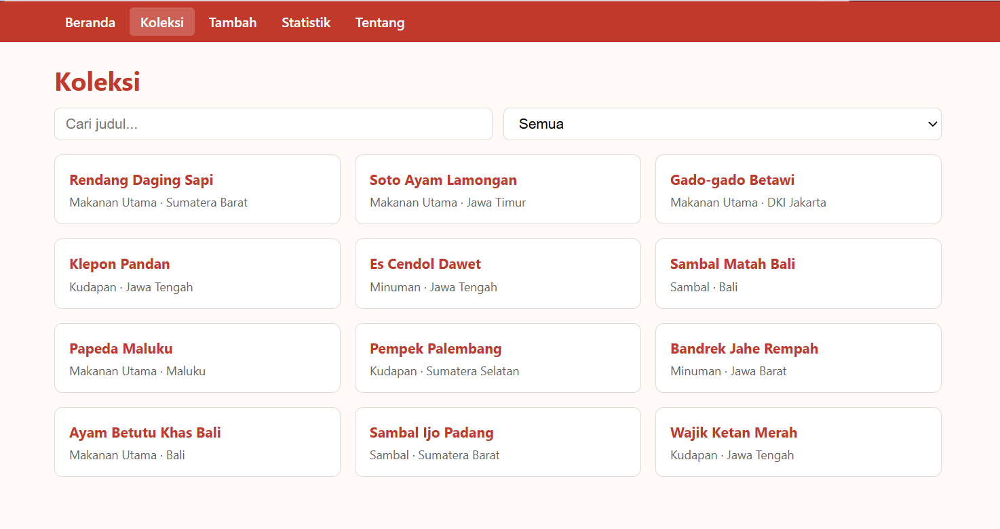

# Ujian Tengah Semester IF25-22014 Pengembangan Aplikasi Web

# Resep Masakan Nusantara

## Identitas Mahasiswa

- Nama: Andre Prasetya Daely
- NIM: 123140131
- Kelas: RB
- Tema: Resep Masakan Nusantara

## Tautan

- Deployment: https://andree050505.github.io/uts-paw/
- Repositori: https://github.com/andree050505/uts-paw

## Fitur Utama

- Beranda: menampilkan ringkasan data koleksi dan kategori unik
- Koleksi: daftar resep dengan fitur pencarian judul dan filter kategori
- Detail: menampilkan informasi lengkap resep beserta tombol hapus
- Tambah Resep: formulir penambahan data dengan validasi input
- Statistik: ringkasan jumlah resep per kategori dalam bentuk tabel
- Tentang: informasi pengembang dan tautan repositori
- Fallback 404: penanganan halaman rute yang tidak ditemukan

## Tangkapan Layar (Koleksi)

